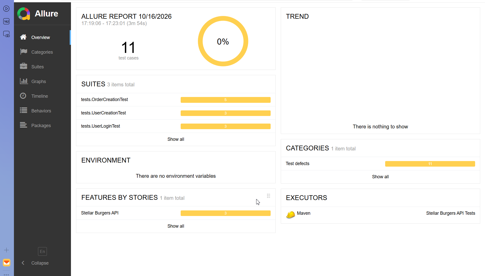
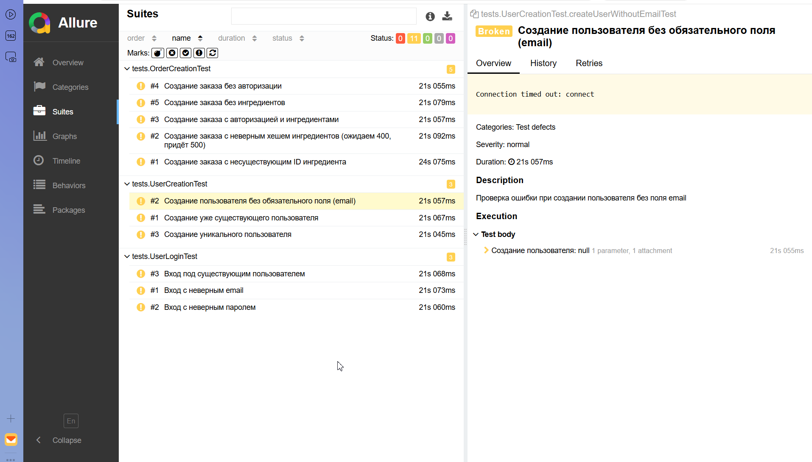

# Diplom_2: API-автотесты для Stellar Burgers

Проект автоматизации тестирования REST API приложения [Stellar Burgers](https://stellarburgers.education-services.ru) на Java 11 с использованием REST Assured, JUnit 4 и Allure.

## Стек технологий

- **Java 11** — язык программирования
- **REST Assured 5.5.5** — тестирование REST API
- **JUnit 4.13.2** — фреймворк для тестирования
- **Allure 2.27.0** — отчётность
- **Jackson 2.17.1** — работа с JSON
- **Lombok 1.18.34** — генерация кода
- **Maven** — сборка проекта

## Структура проекта

```text
src/test/java/
├── base/
│   └── BaseApiTest.java                — базовый класс для API-тестов
├── constants/
│   ├── Config.java                     — URL-адреса эндпоинтов
│   └── TestConstants.java              — константы (статусы, тексты ошибок, ключи JSON)
├── models/
│   ├── Order.java                      — модель заказа
│   └── User.java                       — модель пользователя
├── steps/
│   ├── IngredientSteps.java            — шаги для ингредиентов
│   ├── OrderSteps.java                 — шаги для заказов
│   └── UserSteps.java                  — шаги для пользователей
└── tests/
    ├── OrderCreationTest.java          — 5 тестов создания заказа
    ├── UserCreationTest.java           — 3 теста создания пользователя
    └── UserLoginTest.java              — 3 теста логина
```

## Тесты (11 штук)

### Создание пользователя (`UserCreationTest`) — 3 теста

- ✅ **Создание уникального пользователя** — успешная регистрация с валидными данными
- ✅ **Создание уже существующего пользователя** — ошибка 403 Forbidden
- ✅ **Создание пользователя без обязательного поля (email)** — ошибка 403 Forbidden

### Логин пользователя (`UserLoginTest`) — 3 теста

- ✅ **Вход под существующим пользователем** — успешный логин
- ✅ **Вход с неверным паролем** — ошибка 401 Unauthorized
- ✅ **Вход с неверным email** — ошибка 401 Unauthorized

### Создание заказа (`OrderCreationTest`) — 5 тестов

- ✅ **Создание заказа с авторизацией и ингредиентами** — успешное создание
- ✅ **Создание заказа без авторизации** — ошибка 401 Unauthorized
- ✅ **Создание заказа без ингредиентов** — ошибка 400 Bad Request
- ✅ **Создание заказа с неверным хешем ингредиента** — ожидаем 400, приходит 500
- ✅ **Создание заказа с несуществующим ID ингредиента** — ожидаем 400, приходит 500

## Запуск тестов

### Требования

- **Java 11+** — [скачать](https://www.oracle.com/java/technologies/javase/jdk11-archive-downloads.html)
- **Maven 3.6+** — [скачать](https://maven.apache.org/download.cgi)

### Запуск всех тестов

```bash
mvn clean test
```

### Запуск конкретного тест-класса

```bash
mvn clean test -Dtest=UserCreationTest
mvn clean test -Dtest=UserLoginTest
mvn clean test -Dtest=OrderCreationTest
```

## Особенность запуска

⚠️ **Важно:** на момент сдачи диплома сервер `stellarburgers.education-services.ru` был **недоступен** (из-за технических работ на стороне сервиса).

По этой причине **все 11 тестов падают** с `java.net.ConnectException: Connection timed out: connect` на этапе отправки запросов.

**Это не ошибка кода** — тесты написаны корректно, структура соответствует критериям. Скриншоты Allure-отчёта приведены ниже.

После восстановления доступа к серверу тесты будут перезапущены, и отчёт обновится.

## Allure-отчёты

### Генерация отчёта

```bash
mvn allure:report
```

### Просмотр отчёта в браузере

```bash
mvn allure:serve
```

После выполнения команды отчёт автоматически откроется в браузере.

### Содержание отчёта

- **Overview** — статистика выполнения тестов
- **Suites** — разбиение тестов по классам
- **Graphs** — графики результатов
- **Timeline** — временная шкала выполнения
- **Behaviors** — тесты сгруппированы по Epic/Feature

### Скриншоты

⚠️ Все тесты упали с `Connection timed out` из-за **недоступности сервера** (см. раздел выше).





## Особенности реализации

- ✅ **Все API-запросы через Steps** — методы `UserSteps`, `OrderSteps`, `IngredientSteps` инкапсулируют вызовы REST Assured
- ✅ **Тестовые данные создаются/удаляются** — в `@Before` создаётся пользователь, в `@After` удаляется
- ✅ **Проверка тела и кода ответа** — каждый тест проверяет `statusCode` + `body` через Hamcrest-матчеры
- ✅ **Allure интеграция** — `@Epic`, `@Feature`, `@DisplayName`, `@Description`
- ✅ **Уникальные данные** — email и имя генерируются через `UUID`
- ✅ **Jackson + Lombok** — модели сериализуются/десериализуются автоматически

## Основные компоненты

### BaseApiTest

Базовый класс для всех API-тестов. Автоматически выполняет:

- Устанавливает `RestAssured.baseURI` из `Config`
- Подключает фильтры для логирования (`RequestLoggingFilter`, `ResponseLoggingFilter`)
- Подключает `AllureRestAssured` для генерации отчёта

### UserSteps

Класс-шаг для работы с пользователями:

- `createUser(User user)` — регистрация пользователя
- `loginUser(User user)` — авторизация
- `deleteUser(String accessToken)` — удаление пользователя

### OrderSteps

Класс-шаг для работы с заказами:

- `createOrderWithAuth(Order order, String accessToken)` — создание заказа с токеном
- `createOrderWithoutAuth(Order order)` — создание заказа без токена

### IngredientSteps

Класс-шаг для работы с ингредиентами:

- `getIngredients()` — получение списка ингредиентов
- `getFirstIngredientsIds(int count)` — получение первых N ID ингредиентов

### UserModel

Модель пользователя с Lombok:

```java
@Data
@Builder
@NoArgsConstructor
@AllArgsConstructor
public class User {
    private String email;
    private String password;
    private String name;
}
```

---

Этот проект создан как финальный диплом Яндекс.Практикума по QA-автоматизации.
